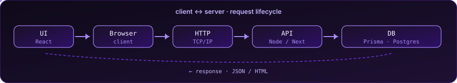

  

  

 

## Обо мне

  

 

Привет — я **leladatan**, fullstack-разработчик из Москвы.

Собираю продукты end-to-end: интерфейс, API, данные, деплой и мобильный клиент. Frontend, backend, React Native и базовый DevOps для меня — связанные части одного процесса, а не разные «вакансии». Понимаю путь запроса от браузера до базы: HTTP, TCP/IP, сети, `client → server → DB`.

Основной стек — **TypeScript** вокруг **React / Next.js** и **Node.js**: App Router, Route Handlers, Prisma + PostgreSQL, Tailwind, auth (Auth.js / Clerk / Supabase). На клиенте — современный UI и стейт (Zustand, TanStack Query). Инфраструктуру поднимаю через **Docker**, GitHub Actions и деплой (Vercel / VPS). Параллельно углубляюсь в **React Native** (iOS / Android).

Кроме веб-продуктов пишу серверы, ботов (Telegram / Discord), утилиты, иногда игры и вспомогательные штуки с ML — всё, что реально экономит людям время. Уровень — middle, с сильной стороной в backend; фронт, мобилка и DevOps развиваю в той же связке.

Портфолио: [leladatan.dev](https://leladatan-dev.vercel.app)

---

## Стек и зона ответственности

<table>
  <tr>
    <td width="33%" valign="top">
      <h3>Backend</h3>
      <ul>
        <li>Node.js · TypeScript</li>
        <li>Next.js App Router / Route Handlers</li>
        <li>Prisma · PostgreSQL · REST</li>
        <li>Auth.js · Clerk · Supabase Auth</li>
        <li>Интеграции: Stripe · gRPC · discord.js</li>
      </ul>
    </td>
    <td width="33%" valign="top">
      <h3>Frontend &amp; Mobile</h3>
      <ul>
        <li>React · Next.js · TypeScript</li>
        <li>Tailwind CSS · shadcn/ui</li>
        <li>Zustand · TanStack Query</li>
        <li>React Native (iOS / Android)</li>
        <li>Vite · FSD при необходимости</li>
      </ul>
    </td>
    <td width="33%" valign="top">
      <h3>DevOps &amp; основы</h3>
      <ul>
        <li>Docker · Compose</li>
        <li>GitHub Actions · CI/CD</li>
        <li>Vercel · VPS-деплой</li>
        <li>Git · Linux · VS Code</li>
        <li>HTTP · TCP/IP · сети</li>
      </ul>
    </td>
  </tr>
</table>

 

  

---

## Технологии

  <strong>Backend</strong> 
  
    
  <strong>Frontend &amp; Mobile</strong> 
  
   
  React Native · Tailwind · Zustand / TanStack Query · shadcn/ui
    
  <strong>DevOps &amp; tools</strong> 
  

Также в опыте

Sass · styled-components · MUI · Ant Design · MobX · RTK · Webpack · yarn / npm · pnpm · Clerk · Auth.js · Stripe · gRPC · discord.js · Figma · GSAP · FSD

---

## Проекты

Часть pet-проектов переписываю с нуля. Live — только у актуальных.

| Проект | Описание | Стек | Demo |
| --- | --- | --- | --- |
| [dream-anime-frontend](https://github.com/Leladatan/dream-anime-frontend) | Anime-платформа с акцентом на UI и motion | Next.js 15 · FSD · GSAP · Tailwind | [live](https://dream-anime-frontend.vercel.app) |
| [leladatan.dev](https://github.com/Leladatan/leladatan.dev) | Личный сайт | React · TypeScript | [live](https://leladatan-dev.vercel.app) |
| [spotify](https://github.com/Leladatan/spotify) | Fullstack-клон Spotify (rewrite) | Next.js · Supabase · Zustand | — |
| [network](https://github.com/Leladatan/network) | Соцсеть (rewrite) | Next.js · Prisma · Auth.js | — |
| [discord](https://github.com/Leladatan/discord) | Discord-like приложение (rewrite) | Next.js · Clerk · Prisma | — |
| [discord-close-bot](https://github.com/Leladatan/discord-close-bot) | Discord-бот | Node.js · discord.js | — |

### Дальше

  

---

## GitHub

  
  

 

  

 

### Contribution snake

<picture>
  <source media="(prefers-color-scheme: dark)" srcset="https://raw.githubusercontent.com/Leladatan/Leladatan/output/github-contribution-grid-snake-dark.svg" />
  <source media="(prefers-color-scheme: light)" srcset="https://raw.githubusercontent.com/Leladatan/Leladatan/output/github-contribution-grid-snake.svg" />
  
</picture>

---

## Контакты

  
  

  

