  

  

 

## Обо мне

  

 

Привет — я **Владимир** (`Leladatan`). Frontend-разработчик из Москвы: собираю продуктовые интерфейсы на **React / Next.js / TypeScript**, иногда дотягиваю бэкенд на **Node.js**.

- Сейчас в фокусе: современный UI, FSD, анимации и чистая архитектура фронта
- Основной стек: Next.js, TypeScript, Tailwind, Prisma, Zustand
- Бэкенд-слой: Node.js, API, auth (Clerk / NextAuth / Supabase)
- Портфолио: [leladatan.dev](https://leladatan-dev.vercel.app)

---

## Стек

  
   
  

Чем ещё пользовался

React Query · gRPC · Stripe · Clerk · NextAuth · shadcn/ui · MUI · Ant Design · MobX · RTK · styled-components · Webpack · yarn/npm · Discord.js

---

## Избранные проекты

| Проект | Что это | Стек | Demo |
| --- | --- | --- | --- |
| [dream-anime-frontend](https://github.com/Leladatan/dream-anime-frontend) | Anime-платформа с акцентом на UI/motion | Next.js 15 · FSD · GSAP · Tailwind | [live](https://dream-anime-frontend.vercel.app) |
| [spotify](https://github.com/Leladatan/spotify) | Fullstack-клон Spotify | Next.js · Supabase · Zustand · Tailwind | [live](https://spotify-two-murex.vercel.app) |
| [network](https://github.com/Leladatan/network) | Соцсеть / pet social | Next 14 · Prisma · NextAuth | [live](https://network-leladatan.vercel.app) |
| [discord](https://github.com/Leladatan/discord) | Discord-like приложение | Next.js · Clerk · Prisma · Zustand | — |
| [leladatan.dev](https://github.com/Leladatan/leladatan.dev) | Личный сайт | React · TypeScript | [live](https://leladatan-dev.vercel.app) |

---

## GitHub

  
  

 

  

 

### Contribution snake

<!-- После первого запуска Actions → Generate Snake появится SVG на ветке output -->
<picture>
  <source media="(prefers-color-scheme: dark)" srcset="https://raw.githubusercontent.com/Leladatan/Leladatan/output/github-contribution-grid-snake-dark.svg" />
  <source media="(prefers-color-scheme: light)" srcset="https://raw.githubusercontent.com/Leladatan/Leladatan/output/github-contribution-grid-snake.svg" />
  
</picture>

---

## Контакты

  
  

  

